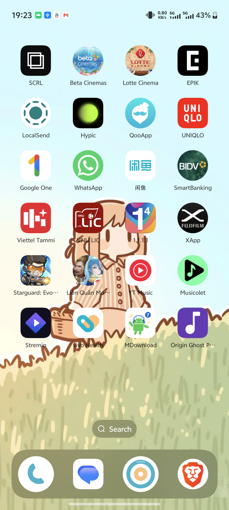
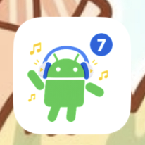
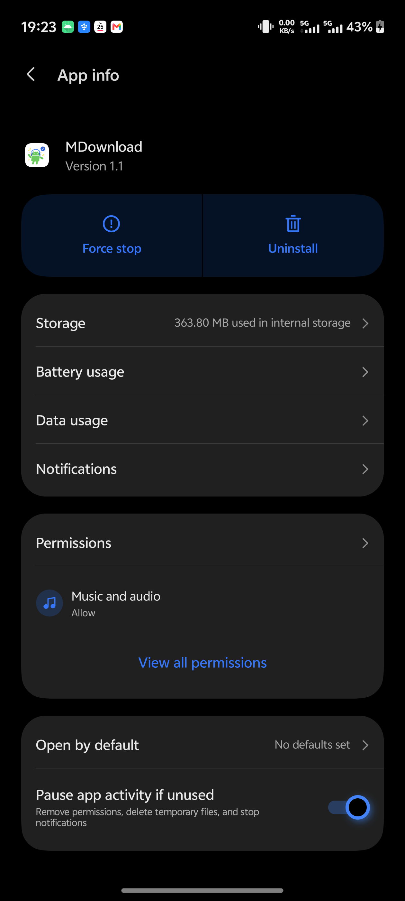

# HiFiDeck Android — Launcher Icon Replacement Report

**Date:** 2026-11-25  
**Application:** HiFiDeck (`com.example.mdownload`, `versionCode = 2`, `versionName = 1.1`)  
**Repository:** `D:\MDownload`  
**Target Device Verified:** vivo X200s (`V2458A`) — OriginOS 7 / Android 17 (API 37, `560 dpi` physical / `525 dpi` override, `1260 × 2800`)

---

## 1. Source Artwork Inspection

| Property | Value |
|---|---|
| **Authoritative File Path** | `D:\Downloads\Android DJ With Musical Notes.png` |
| **File Size** | `1,174,244` bytes (~1.12 MB) |
| **Format & Color Mode** | PNG, RGB (8-bit/channel, no alpha channel) |
| **Dimensions** | `1254 × 1254 px` (1:1 square) |
| **Backdrop Color** | Uniform near-white `#FEFEFE` (`RGB(254, 254, 254)`, border max deviation `≤ 1`) |
| **Artwork Bounding Box** | `(103, 42)` → `(1217, 1203)` (`1115 × 1162 px`, `88.9% × 92.7%` of source canvas) |
| **Dominant Palette** | Android green (`#48C848`), DJ headphone & badge blues (`#1868D8`, `#4888F8`), golden-yellow notes (`#F8C808`), crisp white cutouts |
| **Modification Policy** | Exact supplied artwork preserved — no AI regeneration, redesign, stretching, cropping, or color shifts |

---

## 2. Existing Resource Audit (Before Replacement)

Prior to replacement, `app/src/main/res/` contained default Android Studio placeholder icon resources:

- `AndroidManifest.xml`:
  - `android:icon="@mipmap/ic_launcher"`
  - `android:roundIcon="@mipmap/ic_launcher_round"`
- `res/mipmap-anydpi/ic_launcher.xml` and `ic_launcher_round.xml` (no `-v26` suffix because `minSdk = 35`).
- `res/drawable/ic_launcher_background.xml` (default green `#3DDC84` grid vector).
- `res/drawable/ic_launcher_foreground.xml` (default white Bugdroid vector — also referenced by `DownloadForegroundService.kt` via `.setSmallIcon(R.drawable.ic_launcher_foreground)` at lines 379 and 424).
- `res/mipmap-{mdpi,hdpi,xhdpi,xxhdpi,xxxhdpi}/ic_launcher.webp` and `ic_launcher_round.webp` (legacy default placeholders).

**Key compatibility finding:** Because `DownloadForegroundService.kt` uses `R.drawable.ic_launcher_foreground` as its notification small icon and the downloader pipeline must remain untouched, `ic_launcher_foreground` **must** remain a valid transparent-background drawable so the status bar renders a clean silhouette rather than a solid white square.

---

## 3. Foreground, Background, and Safe-Zone Design Decisions

### Background Layer (`res/drawable/ic_launcher_background.xml`)
- Replaced the default green grid vector with a crisp, solid `#FFFFFF` `108 × 108 dp` vector matching the source artwork's clean white presentation.
- Seamless during adaptive-icon parallax/spring motion on launchers (no seams, edges, or unwanted borders).

### Foreground Layer (`res/drawable-{mdpi,hdpi,xhdpi,xxhdpi,xxxhdpi}/ic_launcher_foreground.png`)
- Extracted the exact Android DJ mascot, blue headphones, blue top-right musical-note badge, and floating golden-yellow notes onto a transparent RGBA canvas using flood-fill segmentation of the `#FEFEFE` backdrop and linear color un-premultiplication across a 5 px anti-aliased fringe (`mean reconstruction error = 0.365 / 255` over `#FEFEFE`, `0.875 / 255` over `#FFFFFF`).
- The exterior backdrop, headphone headband-to-head gap, head-to-torso seam, Bugdroid eyes, and the white eighth-note inside the top-right blue badge are transparent cutouts:
  - Composited over the `#FFFFFF` adaptive background, the eyes and musical note appear pure white — visually identical to the authoritative PNG.
  - On alpha-only surfaces (`DownloadForegroundService` notification small icon), those cutouts keep the mascot silhouette crisp and unmistakable.
- **Safe-Zone Geometry (`108 × 108 dp` canvas, `72 dp` visible viewport, `66 dp` circular safe zone):**
  - Optical center anchored at source `(688.0, 595.0)` (balancing the Android DJ mascot body with the upper-right musical badge and floating notes; enclosing diameter = `1407.0 px`).
  - Resampled with premultiplied-alpha Lanczos filtering so the full artwork enclosing circle maps to `66.0 dp`:
    - Verified `xxxhdpi` (`432 × 432 px`) output: **`max_radius = 33.11 dp`** (aligned to the `33.00 dp` safe-zone radius, leaving `~2.9 dp` of clean white breathing room inside the `36.00 dp` circular mask edge and `~9 dp` inside rounded-square/squircle corners).
    - Artwork bounding box: **`52.5 × 54.5 dp`** (`75.7%` of the `72 dp` visible icon height — bold, crisp, and not excessively shrunk).

### Adaptive Icon Configuration (`res/mipmap-anydpi/`)
Preserved the project's existing `mipmap-anydpi/` directory (appropriate for `minSdk = 35`, avoiding `ObsoleteSdkInt` warnings):

- `res/mipmap-anydpi/ic_launcher.xml`
- `res/mipmap-anydpi/ic_launcher_round.xml`

Both resolve to:
```xml
<adaptive-icon xmlns:android="http://schemas.android.com/apk/res/android">
    <background android:drawable="@drawable/ic_launcher_background" />
    <foreground android:drawable="@drawable/ic_launcher_foreground" />
    <monochrome android:drawable="@drawable/ic_launcher_monochrome" />
</adaptive-icon>
```

---

## 4. Monochrome / Themed Icon Status

- **Status:** Supported with dedicated single-color silhouette assets (`res/drawable-{mdpi,hdpi,xhdpi,xxhdpi,xxxhdpi}/ic_launcher_monochrome.png`).
- **Implementation:** Pure `#FFFFFF` RGB with clean anti-aliased alpha silhouette derived directly from the authoritative artwork's extracted alpha matte (does **not** reuse the colorful PNG directly).
- **Legibility:** Preserves the arched DJ headband gap, Bugdroid head/antennae with eye cutouts, dancing arms & legs, floating musical notes, and the top-right circular badge with its eighth-note cutout — clearly recognizable under Android 13–17 Material You themed-icon tinting.

---

## 5. Generated & Removed Resource Inventory

### Adaptive Foreground & Monochrome Density Variants (`108 × 108 dp`)

| Density | Pixel Size | Foreground Resource (APK size) | Monochrome Resource (APK size) |
|---|---|---|---|
| `mdpi` (1x) | `108 × 108 px` | `res/drawable-mdpi/ic_launcher_foreground.png` (`5,507 B`) | `res/drawable-mdpi/ic_launcher_monochrome.png` (`2,850 B`) |
| `hdpi` (1.5x) | `162 × 162 px` | `res/drawable-hdpi/ic_launcher_foreground.png` (`9,654 B`) | `res/drawable-hdpi/ic_launcher_monochrome.png` (`4,671 B`) |
| `xhdpi` (2x) | `216 × 216 px` | `res/drawable-xhdpi/ic_launcher_foreground.png` (`14,521 B`) | `res/drawable-xhdpi/ic_launcher_monochrome.png` (`6,685 B`) |
| `xxhdpi` (3x) | `324 × 324 px` | `res/drawable-xxhdpi/ic_launcher_foreground.png` (`26,129 B`) | `res/drawable-xxhdpi/ic_launcher_monochrome.png` (`10,855 B`) |
| `xxxhdpi` (4x) | `432 × 432 px` | `res/drawable-xxxhdpi/ic_launcher_foreground.png` (`40,645 B`) | `res/drawable-xxxhdpi/ic_launcher_monochrome.png` (`15,289 B`) |

### Legacy Launcher Icon Density Variants (`48 × 48 dp`, 4× Supersampled Lanczos)

| Density | Pixel Size | Square / Rounded Card (`ic_launcher.png`) | Circular (`ic_launcher_round.png`) |
|---|---|---|---|
| `mdpi` | `48 × 48 px` | `res/mipmap-mdpi/ic_launcher.png` (`2,991 B`) | `res/mipmap-mdpi/ic_launcher_round.png` (`3,231 B`) |
| `hdpi` | `72 × 72 px` | `res/mipmap-hdpi/ic_launcher.png` (`5,316 B`) | `res/mipmap-hdpi/ic_launcher_round.png` (`5,720 B`) |
| `xhdpi` | `96 × 96 px` | `res/mipmap-xhdpi/ic_launcher.png` (`7,874 B`) | `res/mipmap-xhdpi/ic_launcher_round.png` (`8,434 B`) |
| `xxhdpi` | `144 × 144 px` | `res/mipmap-xxhdpi/ic_launcher.png` (`13,955 B`) | `res/mipmap-xxhdpi/ic_launcher_round.png` (`14,840 B`) |
| `xxxhdpi` | `192 × 192 px` | `res/mipmap-xxxhdpi/ic_launcher.png` (`20,561 B`) | `res/mipmap-xxxhdpi/ic_launcher_round.png` (`22,007 B`) |

### XML Definitions Updated
- `res/drawable/ic_launcher_background.xml` (`568 B` compiled)
- `res/mipmap-anydpi/ic_launcher.xml` (`548 B` compiled)
- `res/mipmap-anydpi/ic_launcher_round.xml` (`548 B` compiled)

### Obsolete Placeholder Files Removed (Preventing AAPT2 Duplicate Resource Conflicts)
- `res/drawable/ic_launcher_foreground.xml`
- `res/mipmap-{mdpi,hdpi,xhdpi,xxhdpi,xxxhdpi}/ic_launcher.webp` (5 files)
- `res/mipmap-{mdpi,hdpi,xhdpi,xxhdpi,xxxhdpi}/ic_launcher_round.webp` (5 files)

### Manifest & Code Preservation
- `app/src/main/AndroidManifest.xml` already declared `android:icon="@mipmap/ic_launcher"` and `android:roundIcon="@mipmap/ic_launcher_round"` — **zero manifest modifications required**.
- Zero Kotlin/Java source files modified. All P0, P1, STAB-05, Media3, Downloader, ReplayGain, Metadata Editor, Smart Playlists, Sleep Timer, Orbital Navigation, Circular Scrubbing, Lyrics, and `SafeAudioWritePipeline` implementations remain untouched.

---

## 6. Build & Compiled APK Verification

| Check | Result |
|---|---|
| **Gradle Build** (`:app:assembleArm64Debug`) | **PASSED** (`app-arm64-debug.apk`, `126.87 MB`) |
| **Unit Tests** (`:app:testArm64DebugUnitTest`) | **PASSED** (`117 passed, 0 skipped, 0 failed`) |
| **APK Icon Entries** | All `23` expected icon resources present (`10` adaptive foreground/monochrome PNGs, `10` legacy PNGs, `1` background XML, `2` adaptive XMLs); `0` stale `.webp` files |
| **`aapt2 dump badging`** | `package: name='com.example.mdownload'`, `application-icon-{160,240,320,480,640,65534}: 'res/mipmap-anydpi-v21/ic_launcher.xml'` |
| **`aapt2 dump xmltree`** | Both `ic_launcher.xml` and `ic_launcher_round.xml` cleanly resolve `<background>`, `<foreground>`, and `<monochrome>` drawable IDs (`@0x7f07005d`, `@0x7f07005e`, `@0x7f07005f`) |
| **Preserved Assets** | `res/raw/ytdlp` intact inside APK |

---

## 7. Device Verification (vivo X200s — OriginOS 7 / Android 17)

1. **In-Place Installation:** Installed `app-arm64-debug.apk` via `adb install -r` (`Performing Streamed Install -> Success`) **without** uninstalling or clearing private application data.
2. **Data Preservation Confirmed:** Existing playback history (`Continue listening: MR. SIRO | Không Muốn Yêu Lại Càng Say Đắm | Official Audio`), local albums (`Download`, `Hoa sua`, `Music`), and `yt-dlp ready` state loaded intact.
3. **OriginOS 7 Home Screen Verification:**
   - Located `MDownload` on OriginOS Home Screen Page 3 (`bounds=[647,1651][899,1952]`).
   - Icon refreshed immediately without launcher cache reset or app uninstall.
   - Full Android DJ mascot, blue headphones, blue top-right musical-note badge, and golden-yellow musical notes render cleanly inside the OriginOS rounded-square/squircle mask with balanced white padding and zero cropping.
4. **System App Info Verification:**
   - Inspected `InstalledAppDetails` (`entity_header_icon`, `bounds=[66,433][164,531]`, `98 × 98 px`).
   - Icon renders cleanly with accurate colors and zero clipping at small list/header size.
5. **App Launch & Media3 Playback Verification:**
   - Tapped the new launcher icon directly on OriginOS Home Screen → `com.example.mdownload/.MainActivity` opened normally.
   - Tapped Play → `dumpsys media_session` confirmed active `androidx.media3.session.id.hifideck_audio_session` (`state=PLAYING(3)`, `active=true`, `error=null`, track metadata preserved; album artwork unaffected), then paused cleanly.

---

## 8. Verification Screenshots

- Adaptive mask & safe-zone composite (108dp guides, circle, OriginOS rounded-square, squircle, Material You monochrome):  
  
- vivo X200s OriginOS 7 Home Screen (Page 3 — `MDownload` at row 6, column 3):  
  
- vivo X200s OriginOS Home Screen icon crop (`206 × 206 px`):  
  
- vivo X200s Android App Info screen & icon crop (`98 × 98 px`):  
    
  

---

## 9. Compatibility Notes & Limitations

- **Launcher Icon Packs / OEM Themes:** OriginOS supports custom third-party icon packs and custom icon-style themes that may override or restyle app icons globally; under standard OriginOS icon shapes (rounded-square, squircle, circle) and Material You themed icons, the new adaptive and monochrome layers render natively.
- **Directory Naming (`mipmap-anydpi/`):** Retained `res/mipmap-anydpi/` rather than `mipmap-anydpi-v26/` because the project targets `minSdk = 35` (AGP compiles it to `res/mipmap-anydpi-v21/ic_launcher.xml` with zero lint warnings). If `minSdk` were ever lowered below 26, renaming `mipmap-anydpi/` to `mipmap-anydpi-v26/` would be required so API 21–25 devices fall back to the generated `mipmap-*dpi/ic_launcher*.png` legacy assets.
- **Download Notification Small Icon:** `DownloadForegroundService.kt` continues referencing `R.drawable.ic_launcher_foreground` unchanged. Because the foreground layer uses a transparent background with crisp alpha cutouts for the mascot's eyes, headband gap, and badge note, the status bar renders a clean Android DJ silhouette rather than a solid box.
